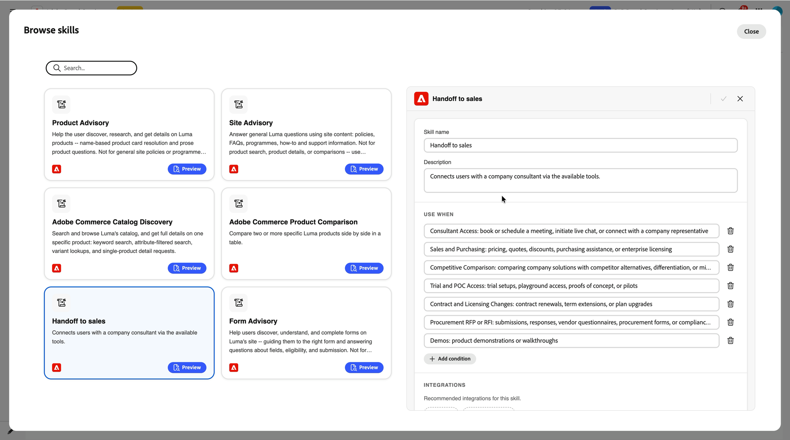

# Live-Chat und Meeting-Buchung aktivieren {#configure-in-composer}

Zwei Dinge müssen im Komponisten vorhanden sein. Die **[!UICONTROL Meeting-]**- und **[!UICONTROL Live-Chat]**-Integrationen geben dem Concierge die *Möglichkeit* die Verfügbarkeit zu überprüfen, einen Chat zu starten und einen Slot zu buchen. Die **[!UICONTROL Übergabe an den Verkauf]**-Fähigkeit sagt ihm *wann* diese Fähigkeit zu nutzen.

>[!NOTE]
>
>Schließen Sie [Zuerst Repräsentanten in Adobe Marketo Qualifier &#x200B;](representative-setup.md). Die Integrationen überprüfen die Verfügbarkeit von verbundenen Kalendern und Live-Chats und werden ohne diese nicht aktiviert.

## Verbinden der Integration der Besprechungsbuchung {#connect-meeting-booking}

1. Öffnen Sie in Composer Ihren Concierge und wählen Sie **[!UICONTROL Integrationen]** > **[!UICONTROL Integrationen durchsuchen]**.

   **[!UICONTROL Meeting-Buchung]** und **[!UICONTROL Live-Chat]** werden unter **[!UICONTROL Integrierte Integrationen]** angezeigt.

   {width="800" zoomable="yes"}

1. Wählen Sie **[!UICONTROL Besprechungsbuchung]** und dann **[!UICONTROL Konfigurieren]** aus.

1. Geben Sie einen Namen und eine Beschreibung ein.

   Benennen Sie die Integration für die Funktionen in diesem Concierge, z. B. `Meeting booking - US region` oder `Meeting booking - round robin`. Sie können mehrere Verbindungen herstellen. Der Name ist also, wie Sie sie später unterscheiden.

1. Überprüfen Sie den Kalenderverbindungsstatus.

   Die Integration überprüft, ob mindestens ein Vertreter in Ihrer Organisation über eine Kalenderverbindung verfügt.

   * Wenn kein Kalender aktiviert ist, werden Sie durch einen Fehler aufgefordert, vor der Aktivierung der Besprechungsbuchung mindestens einen Kalender zu verbinden. Kehren Sie zu [!DNL Adobe Marketo Qualifier] zurück und füllen Sie [Kalender verbinden](representative-setup.md#connect) aus.
   * Wenn mindestens ein Benutzer über verfügt, wird durch eine Bestätigung angezeigt, dass Vertreter verfügbar sind.

1. Wählen Sie einen Routing-Typ aus **[!UICONTROL (Round]**), **[!UICONTROL Direct Agent]** oder **[!UICONTROL Custom Routing]**.

   Wenn Sie **[!UICONTROL Direct Agent]** auswählen, wählen Sie den Vertreter aus, der jedes über diesen Concierge gebuchte Meeting erhält. Wenn Sie **[!UICONTROL Benutzerdefiniertes Routing]** auswählen, werden die [!DNL Adobe Marketo Qualifier] erstellten Routing-Regeln angewendet. Weitere Informationen zum Verhalten der einzelnen [&#x200B; finden Sie unter „Routen von Konversationen an Vertreter](routing-rules.md).

1. Wählen Sie **[!UICONTROL Verbinden]** aus.

## Verbinden der Live-Chat-Integration {#connect-live-chat}

1. Wählen **[!UICONTROL unter „Integrationen]**&quot; die Option **[!UICONTROL Live-Chat]** und dann **[!UICONTROL Konfigurieren]** aus.

1. Geben Sie einen Namen und eine Beschreibung ein, z. B. `Live chat - round robin`.

1. Überprüfen Sie den Status der Verfügbarkeit des Live-Chats.

   Die Integration überprüft, ob mindestens ein Mitarbeiter die Verfügbarkeit des Live-Chats festgelegt hat.

   * Wenn dies nicht der Fall ist, werden Sie aufgefordert, Vertreter hinzuzufügen, die ihre Live-Chat-Verfügbarkeit eingerichtet haben. Kehren Sie zu [!DNL Adobe Marketo Qualifier] zurück und schließen Sie [Live-Chat-Verfügbarkeit festlegen](representative-setup.md#chat-availability) ab.
   * Wenn mindestens ein Benutzer über verfügt, wird durch eine Bestätigung angezeigt, dass Vertreter verfügbar sind.

1. Routing-Typ auswählen.

   Der Live-Chat unterstützt die gleichen drei Routing-Typen wie die Besprechungsbuchung. Mit **[!UICONTROL Round Robin]** wird jeder berechtigte Vertreter sofort benachrichtigt und der erste, der den Chat akzeptiert.

1. Wählen Sie **[!UICONTROL Verbinden]** aus.

## Handoff an Sales-Kenntnisse aktivieren {#activate-skill}

Die Integrationen sind nun miteinander verbunden, aber der Concierge muss immer noch wissen, wann er sie anbieten soll. Das ist die Aufgabe der Fertigkeit.

1. Wählen Sie in Composer **[!UICONTROL Fähigkeiten]** > **[!UICONTROL Kenntnisse durchsuchen]** und wählen Sie dann **[!UICONTROL Übergabe an den Vertrieb]**.

   Im Detailbereich werden die Qualifikationsbeschreibung, die **[!UICONTROL Verwenden, wenn]** Bedingungen, die empfohlenen **[!UICONTROL Integrationen]** und die **[!UICONTROL Qualifikationsanweisungen]** angezeigt.

   {width="800" zoomable="yes"}

1. Wählen Sie **[!UICONTROL Ändern]** aus.

   {width="800" zoomable="yes"}

1. Überprüfen Sie den Namen und die Beschreibung der Qualifikation und bearbeiten Sie sie, falls gewünscht.

1. Lesen Sie die Bedingungen **[!UICONTROL Verwenden Sie wenn]**.

   Das sind die Absichten, die Trigger einer Übergabe. Die Qualifikation wird mit einem Standardsatz ausgeliefert:

   | Bedingung | Trigger am |
   | --- | --- |
   | Zugriff für Berater | Buchung oder Planung eines Meetings, Starten eines Live-Chats oder Ersuchen, sich mit einem Unternehmensvertreter zu verbinden |
   | Verkauf und Einkauf | Preise, Angebote, Rabatte, Kaufunterstützung oder Enterprise-Lizenzierung |
   | Wettbewerbsvergleich | Vergleich Ihrer Lösungen mit Alternativen, Unterscheidungen oder Migrationen von Mitbewerbern |
   | Test- und POC-Zugriff | Testsetup, Zugang zum Spielplatz, Machbarkeitsstudien oder Pilotprogramme |
   | Vertrags- und Lizenzänderungen | Vertragsverlängerungen, Laufzeitverlängerungen oder geplante Upgrades |
   | Procurement RFP oder RFI | Einreichungen, Antworten, Lieferantenfragebögen, Beschaffungsformulare oder Compliance-Dokumentation |
   | Demos | Produktdemonstrationen oder exemplarische Vorgehensweisen |

   Wählen Sie **[!UICONTROL Bedingung hinzufügen]** aus, um einen eigenen Intent hinzuzufügen oder eine Bedingung zu löschen, die nicht für Ihr Unternehmen gilt.

1. Fügen Sie die verbundenen Integrationen hinzu.

   Fügen Sie **[!UICONTROL Live]**, **[!UICONTROL Meeting-Buchung]** oder beides hinzu, je nachdem, was Sie von diesem Concierge erhalten möchten.

1. Lesen Sie die **[!UICONTROL Anleitungen für Kenntnisse]**.

   Die Anweisungen werden für Sie aus den von Ihnen ausgewählten Bedingungen und Integrationen generiert, sodass in den meisten Fällen keine Bearbeitung erforderlich ist.

   Bearbeiten Sie sie in einfacher Sprache, wenn Sie eine genauere Kontrolle darüber wünschen, welcher Intent zu welcher Option führt. Beispielsweise können Sie den Concierge anweisen, Live-Chat für Preisfragen anzubieten, ein Meeting für Demoanfragen anzubieten und beides für Fragen zur Beschaffung anzubieten.

1. Wählen Sie **[!UICONTROL Speichern]** aus.

## Testen und Veröffentlichen {#test-and-publish}

Öffnen Sie die Vorschau und fragen Sie den Concierge nach etwas, das einer der **[!UICONTROL Wenn verwenden]**-Bedingungen entspricht, z. B. eine Demo anzufordern. Der Concierge sollte anbieten, Sie mit einem Spezialisten zu verbinden, die Chat-Option, die Meeting-Option oder beides zu zeigen und die echte Verfügbarkeit zu präsentieren.

Wenn das Verhalten richtig ist, veröffentlichen Sie Ihren Concierge, um die Übergabe auf Ihrer Website live zu machen.

## Nächster Schritt {#next}

Ihre Vertreter können jetzt Chats empfangen. Siehe [Chat-](chat-inbox.md).
